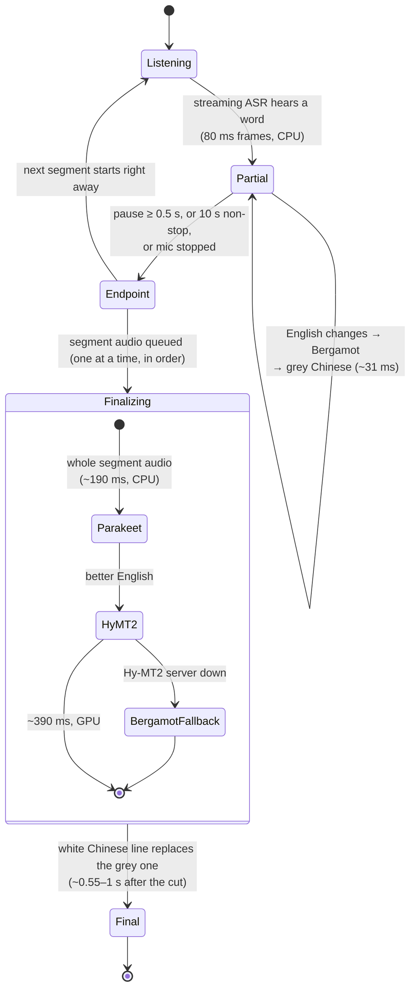

# livecaption

> 🎤 **You speak → 💬 translated subtitles in another language appear on screen in about a second, all running on one home PC.**

Any language pair whisper and Hy-MT2 support. The faster two-stage mode (`/live`) hears 17 languages and captions them in Chinese. A proof of concept, not a product. Tested on a GTX 1060 6GB, i7-7700K and 16 GB RAM.

## State of the POC (2026-11-18)

There are two pipelines in one Node server:

| | `/` (first version) | `/live.html` (current, 17 spoken languages → Chinese) |
|---|---|---|
| How it works | Browser VAD cuts utterances → whisper base (CPU) → Hy-MT2 1.8B (GPU) | Streams 80 ms audio frames. A fast guess appears right away, then a better final replaces it |
| Languages | Any whisper can hear → any Hy-MT2 target (set with `start.ps1`) | Picked on the page: en, es, fr, de, it, pt, nl, tr, ru, ar, hi, ja, ko, vi, uk, pl, cs → Simplified Chinese |
| Delay you see | ~0.7–0.8 s after the 0.7 s end-of-speech pause | Grey Chinese ~0.4–0.5 s after a word (English), ~0.65–0.8 s after speech starts (es/de, GPU); white final ~0.2–1 s after a pause or the 10 s cap |
| Proof | Recordings in `verify/media/` (EN→DE, ES→ZH) | `live.test.js`, `eval.js` and a screenshot in `verify/media/` |

**Works:**
- Live mic captions in the browser.
- Two-stage EN→ZH: the translation work behind a partial is 31 ms p50 / 58 ms p90, which meets the 100–150 ms target.
- 16 more spoken languages on `/live` (see "Other spoken languages" below), optionally with the speech model on the GPU.
- Token auth on every route.
- A repeatable quality score (`eval.js`).
- Cloudflare Worker front end, tested locally against Node.

**Not done or not proven:**
- The `workersai` mode has never run, because there is no Cloudflare account yet.
- Nothing is deployed.
- The app translates into the 15 pilot languages (+ English for other speakers), up to 4 at once. More targets per session need more RAM (each Bergamot model is a few hundred MB loaded).
- Japanese is slow to show up (~2.2 s before any text), and live error rates on joined clips are noisy (one German run 12.5%, another 47.9%).
- English decoding runs on Node's main thread; built for a few viewers.
- GPU mode fills the 6 GB card (5.8 GB with Hy-MT2) and takes ~1 min to start. Both models share the GPU, so about 1 white caption in 9 waits 1.5–5.5 s instead of ~0.2 s.
- The CPU does everything except Hy-MT2. A busy CPU (for example a compile running at the same time) pushes finals to 2–10 s.
- No speaker separation, no noise handling beyond the models themselves.
- Scored on one test set of read-aloud speech. Live, spontaneous speech is untested beyond one 30 s YouTube clip.

### How a caption moves through `/live`

Each segment of speech goes through these states (`live.js`). The fast path and the final path run at the same time: while one segment is being finalized, the next one is already showing partials.



This is the English path. For other spoken languages the streaming model is Nemotron (in its own process, CPU or GPU), the grey translation chains two Bergamot models through English, and Finalizing skips Parakeet: Hy-MT2 gets the streaming text directly.

### Progress so far

1. **Latency budget.** Hy-MT2 1.8B Q4 on the GTX 1060 (Vulkan) translates a sentence in ~150–400 ms. A 300 ms total budget is not reachable with whisper first, so the budget was relaxed to ~1 s for captions.
2. **First POC (`/`).** Browser VAD → whisper base → Hy-MT2. About 0.75 s per sentence after the pause. Translated text streams token by token. Pinning the source language saves ~220 ms of ASR.
3. **Benchmark on a YouTube clip (30 s).** Tested many ASR and MT options against the 100–150 ms goal. No single model gets there, so the answer is two stages:
   - Fast and rough: streaming NeMo FastConformer CTC + Bergamot (Firefox's offline translation model).
   - Slow and good: Parakeet 110M on each finished segment + Hy-MT2.
4. **`/live` built on that.** Partials only show text that two translations in a row agree on, which cut visible rewrites from 103 to 21 in 30 s.
5. **Eval harness (`eval.js`)**, results below. Main finding: translation is not the weak spot; speech recognition errors and segment cuts are.
6. **10 s segment cap** instead of 5 s (better chrF and WER on the eval).
7. **Other spoken languages.** Nemotron 3.5 ASR streaming (one model, 32 languages) + Bergamot through English for the grey line, Hy-MT2 for the white line. Runs on the CPU (560 ms model) or the GPU (80 ms model, ~35% faster grey captions).
8. **First pilot scope: English in, 15 targets out (`eval-targets.js`).** All 15 have a fast Bergamot path. On human English, Hy-MT2 never beats Bergamot by more than noise (+0.4 at best), and it is weakest and slowest on the Indic languages.
9. **Cebuano–English check (`eval-ceb.js`).** Bergamot has no Cebuano model. Its Tagalog model handles Filipino well (chrF 67.9) but not Cebuano (40.6, often nonsense). Hy-MT2 scores 44.2 on Cebuano and is not good enough either. Cebuano needs its own speech and translation models.
10. **End-to-end eval through the servers (`eval-live.js`).** FLEURS audio streamed over `/live` on the Node and the Elixir server, 4 targets per session. Both score the same, and the white line is +5 to +21 chrF over the grey line on every target. See "End-to-end through the servers".

### Proposed direction for a real-time translation app (from the numbers below)

- **One English speech pass per speaker, translated per viewer.** The server recognizes speech once and broadcasts English, grey and white lines kept separate. Each viewer picks a target language.
- **Translate in the viewer's browser with Bergamot** (what Firefox uses offline). About 40 MB per language, 26–75 ms per segment. Server cost stays the same with more viewers or languages. If phones are too slow, run Bergamot on the server, only for languages someone is watching.
- **Probably drop Hy-MT2.** On human English it never beats Bergamot by more than noise on any of the 15 targets. It is 5–20× slower and causes the GPU contention behind the slow white lines. Check first: score Bergamot on Parakeet's text, add COMET, and have native speakers review ~20 sentences per language.
- **Spend the effort on speech recognition.** Recognition errors and segment cuts cost ~5 chrF points; translation is fine. Use Parakeet 0.6B on a server GPU for the white line, and cut segments at sentence ends instead of any 0.5 s pause.
- **Server:** recognition only, on a small GPU or a few CPU cores per speaker. English decoding moves to a worker thread. The Cloudflare Worker stays as auth, WebSocket relay and static page.
- **Before anything public:** rotate the app token. Check the model licences (Bergamot/Firefox, NVIDIA Parakeet/Nemotron, Tencent's Hy-MT2 terms). Build a test set of real spontaneous speech from the target domain; FLEURS is read speech.
- **Not in the pilot:** other spoken input languages (the Nemotron path exists), Cebuano (see below), telling speakers apart, noise handling.

## Quick start (Docker): macOS, Windows, Linux

**1. Install Docker Desktop and start it.** OrbStack or Colima also work on a Mac. Give Docker at least 6 GB of memory (Settings → Resources).

**2. Get the code.**

```bash
git clone https://github.com/Freenistry/livecaption.git
cd livecaption
```

**3. Start it.** The first run downloads ~3 GB and takes ~10–15 min. Later runs take under a minute.

| Your machine | Command | Stop |
|---|---|---|
| **macOS** (Apple Silicon or Intel) | `./docker-up.sh` | `./docker-up.sh down` |
| **Windows** (PowerShell) | `.\docker-up.ps1` | `.\docker-up.ps1 -Down` |
| **Linux** | `./docker-up.sh` (`LLAMA_BUILD=ubuntu-vulkan-x64 ./docker-up.sh` for a Vulkan GPU) | `./docker-up.sh down` |

Each script:
- runs Hy-MT2 natively on the GPU: Metal on a Mac, Vulkan on Windows. Docker cannot reach the GPU there.
- runs the Node and Elixir servers in containers.
- opens **http://localhost:3000** in your browser.

The Elixir server is on http://localhost:3001; both serve the same app.

**4. Use the app.**
1. Pick the language you speak and up to 4 languages to translate into.
2. Click **Test microphone** and allow access. Say something until it says "Microphone works".
3. Click **Start** and speak. Grey text is the fast guess; it turns black when the final translation arrives (~1 s after you pause).

**If something goes wrong:**
- **"Docker is not running":** start Docker Desktop and wait until it says it is running.
- **macOS asks to allow `llama-server` incoming connections:** click Allow. The containers reach it over the network.
- **Windows Firewall asks about `llama-server.exe`:** allow it on private networks.
- **Microphone blocked:** click the icon left of the address bar, allow the microphone, then **Test again**. The mic works only on `http://localhost`, not on your machine's IP address.
- **First captions are slow (10–30 s):** the models warm up on the first session after a start. Stop and start again.
- **Logs:** `docker compose logs node`, `docker compose logs elixir`, and `data/host-llama.log` for Hy-MT2.

Hy-MT2 runs outside Docker; the containers call it at `host.docker.internal:8099` (`docker-compose.host-llm.yml`).

Tested 2026-11-19 on Windows, warm, one target: white captions arrived 0.86 s (Elixir) and 1.15 s (Node) after the pause. The CPU-only llama container took ~22 s.

**macOS status:** the scripts and images are built for it, but no real Mac has run them yet. What was checked from Windows:
- Both images build for Apple Silicon (`linux/arm64`), and both start and answer `/api/languages` under emulation.
- Bergamot translates correctly in the arm64 image (emulated).
- `docker-up.sh` passes `bash -n`.

Speech recognition in an emulated arm64 container is too slow to judge; on a real Mac the image runs natively.

## Run it in Docker without the host GPU

Hy-MT2 runs in a container on the CPU, unless `docker-compose.gpu.yml` applies:

```bash
docker compose up -d --build                    # Node server -> http://localhost:3000, Elixir server -> http://localhost:3001
docker compose up -d --build node               # just one of them (or: elixir)
SPOKEN="es de ja" docker compose up -d --build  # also these spoken languages
docker compose down                             # stop (models stay in the "models" volume)
```

What starts:
- **`models`** downloads every model into a shared volume and checks its sha256 (`setup.sh` with `MODELS_ONLY=1`). It takes ~10 min the first time and seconds after that, then exits.
- **`llama`** is llama.cpp's official server image running Hy-MT2, pinned to build b12464 by digest.
- **`node`** runs `server.js`.
- **`elixir`** runs the Elixir release, with `engine.js` as its Node child.
- Both servers wait until the models are loaded before reporting healthy, and listen on 127.0.0.1 only.
- `APP_TOKEN=... docker compose up -d` turns on the token check.

Tested 2026-11-19 on Docker Desktop (Windows, WSL2, CPU only):
- All three services were healthy, and `live.test.js` passed against both servers (exit 0).
- `verify/mic-check.js` passed against both (exit 0): Start stayed locked until the fake mic was heard, captions appeared, and the blocked-mic message showed.
- **Hy-MT2 runs on the CPU in Docker here, so it is slow.** White captions took ~22 s after a pause; the grey line took 110 ms per update. For real-time use, run Hy-MT2 outside Docker on the GPU (`serve.ps1`), or use `docker-compose.gpu.yml` with a new enough driver.
- **`docker-compose.gpu.yml`** uses the CUDA image and needs an NVIDIA driver with CUDA ≥ 12.8. It was refused on this machine's driver 536 (CUDA 12.2). The Vulkan image does not see the GPU inside Docker Desktop either.

## Set it up on macOS / Linux (Elixir server)

Needs Elixir ≥ 1.18 (`brew install elixir`, or https://elixir-lang.org/install.html; Ubuntu's apt package is too old), Node ≥ 20, curl, tar and bzip2.

```bash
./setup.sh              # models for English speech -> the 15 pilot targets, llama.cpp, Hy-MT2, Elixir deps (~2 GB)
./setup.sh es de ja     # also these spoken languages (adds ~0.7 GB + ~40 MB each)
./serve.sh              # starts llama-server + the Elixir app in the background; returns once ready
./serve.sh status       # running?   (logs: data/app.log, data/llama.log)
./serve.sh stop
./serve.sh fg           # foreground; Ctrl+C stops both
```

Then open http://localhost:3000. It's the same page and the same `/live` protocol as the Node server.

How it is split:
- **`server_ex/` (Elixir, Bandit + Plug)** handles HTTP, WebSockets and the token check.
- **`engine.js`** is one Node child process that runs the models: sherpa-onnx and Bergamot only ship Node bindings.
  - Each browser socket is one session, multiplexed over the child's stdin/stdout as length-prefixed frames.
  - If the child crashes, the supervisor restarts it and open sockets close.
- **Hy-MT2** runs on llama.cpp: Metal on Apple Silicon, CPU on Linux, or `LLAMA_BUILD=ubuntu-vulkan-x64 ./setup.sh` for a Vulkan GPU.

Tested 2026-11-19 in a clean `elixir:1.19.7-otp-28` Linux container (Debian, x86-64, CPU only):
- `setup.sh es`, then `serve.sh`.
- English → Spanish/Chinese/Hindi and Spanish → English captions passed `live.test.js`.
- `serve.sh stop` left no processes behind.
- Without a GPU, Hy-MT2 is slow: white lines arrived 8–17 s after the pause, against ~0.5–1.5 s on the GTX 1060. The grey line was 85–145 ms per update.
- **Not tested on a Mac.**
- The GPU speech model (`-Gpu` on Windows) is not wired up here; non-English speech uses the CPU Nemotron model.

## Set it up locally (Windows)

**You need:**
- Windows 10/11
- [Node.js](https://nodejs.org) 22 or newer (tested on 24.22)
- [Git for Windows](https://git-scm.com/download/win), for its `tar` + `bzip2`
- A GPU with a Vulkan driver and ~1.5 GB free VRAM. Any recent NVIDIA, AMD or Intel driver works.
- ~2 GB of disk (~2.3 GB with the eval data). Other languages add ~0.7 GB plus ~40 MB per language; GPU mode adds ~5 GB.
- GPU mode only: an NVIDIA card with ~4 GB free VRAM next to Hy-MT2 (tested: GTX 1060 6GB, driver 536)

**1. Get llama.cpp and the Hy-MT2 model.** Put both in a `bench` folder next to this repo, or set `VENDOR_BENCH_DIR` to another folder.

```powershell
cd ..                     # the folder that contains livecaption\
mkdir bench; cd bench
# llama.cpp, Vulkan build (b12428 is the tested one; newer should work)
curl.exe -LO https://github.com/ggml-org/llama.cpp/releases/download/b12428/llama-b12428-bin-win-vulkan-x64.zip
tar -xf llama-b12428-bin-win-vulkan-x64.zip
# Hy-MT2 1.8B, 4-bit (1.1 GB). The scripts expect this exact file name
curl.exe -L -o Hy-MT2-Q4.gguf https://huggingface.co/tencent/Hy-MT2-1.8B-GGUF/resolve/main/Hy-MT2-1.8B-Q4_K_M.gguf
cd ..\livecaption
```

**2. Fetch everything else and install.**

```powershell
.\setup.ps1                      # English /live + the first version
.\setup.ps1 -Langs es,de,ja      # also these spoken languages on /live
.\setup.ps1 -Langs es,de -Gpu    # ...with the speech model on the GPU (NVIDIA, ~5 GB download)
```

`setup.ps1`:
- Downloads whisper.cpp and whisper base.
- Downloads the three English `/live` models (~300 MB). Every file is checked against a pinned sha256.
- With `-Langs`: the multilingual speech model (650 MB) and one Bergamot model per language (`get-models.js`, checked against Mozilla's published hashes).
- With `-Gpu`: the full-size 80 ms speech model (2.5 GB), sherpa-onnx's CUDA build, and CUDA 12.8 + cuDNN 9 DLLs from NVIDIA's pip packages (no CUDA toolkit install).
- Runs `npm install`.
- Fails with a clear message if anything is missing.

**3. Run.**

```powershell
.\serve.ps1                                                   # everything in the background; returns when the API is up
.\serve.ps1 -Status                                           # running?  (logs: data\serve.log)
.\serve.ps1 -Stop                                             # stops node, whisper and llama-server
.\start.ps1                                                   # same, in the foreground; Ctrl+C stops all
.\start.ps1 -SourceLang es -TargetLang "Simplified Chinese"   # fixed pair for /index.html; skips whisper's language detection
.\start.ps1 -Gpu                                              # (or serve.ps1 -Gpu) non-English speech model on the GPU
```

- **http://localhost:3000**: the app. Pick the language you speak and 1–4 languages to translate into, click Start, speak. Each target gets its own line: grey while it is a fast guess, black once the final arrives.
- **http://localhost:3000/live.html**: the older one-target debug page, with timings under each caption.
- **http://localhost:3000/index.html**: the first version, any language pair.

Target models: `foreach ($t in 'hi','es','ar','fr','bn','pt','ru','id','ur','de','ja','mr','vi','te') { node get-models.js --to=$t en }`. Targets without a model show greyed out. The API behind the page:
- `GET /api/languages` lists the spoken languages and targets, and whether each one's models are installed.
- `WS /live?lang=en&to=zh-Hans,es,hi` takes 80 ms PCM16 frames and sends `src_partial`, `tr_partial` and `final` messages, each tagged with `to`.

The white line uses Hy-MT2 for Chinese, the European languages, Arabic, Indonesian, Japanese and Vietnamese. For Hindi, Bengali, Urdu, Marathi and Telugu it uses Bergamot on Parakeet's text, because Hy-MT2 scored lower and ran slower there (see "First pilot").

**4. Check it works without a mic.**

```powershell
node live.test.js some-16khz-mono.wav ws://127.0.0.1:3000/live           # prints captions + latency, fails if none arrive
node live.test.js spanish.wav "ws://127.0.0.1:3000/live?lang=es"         # another spoken language
node eval.js n=30                                                 # quick quality score (first run downloads 171 MB)
```

Before exposing the box through a tunnel, set `$env:APP_TOKEN` to a long random string. Once it is set, every route requires it; open the page with `?token=...`.

Env (server.js): `PORT=3000`, `ASR_URL=http://127.0.0.1:8081`, `MT_URL=http://127.0.0.1:8099`, `TARGET_LANG=German`, `SOURCE_LANG=auto`, `APP_TOKEN`, `ASR_GPU=1` (set by `start.ps1 -Gpu`).

## Live two-stage captions, English → Chinese (`/live`)

Open http://localhost:3000/live.html. The page streams 80 ms PCM frames over a WebSocket and gets two kinds of captions:

| | Fast partial (grey) | Final (replaces it) |
|---|---|---|
| ASR | NeMo streaming FastConformer CTC 80 ms, int8, CPU 2 threads (sherpa-onnx) | Parakeet TDT-CTC 110M int8, CPU, on the whole segment |
| MT | Bergamot en→zh-Hans 2.2 (Firefox's model), WASM in a worker thread | Hy-MT2 via llama-server :8099 (falls back to Bergamot if it is down) |
| When | every time the English partial changes | after a 0.5 s pause, or every 10 s of continuous speech |

Measured with `node live.test.js <clip.wav> ws://127.0.0.1:3000/live` on the first 30 s of a YouTube talk (one English speaker, almost no pauses), warm, light background load. Median of 3 runs per setting, back to back on 2026-11-17.

| | 10 s cap (current) | 5 s cap |
|---|---|---|
| Chinese partial: Bergamot time per update, p50 / p90 | 51 / 97 ms | 32 / 56 ms |
| Final: cut → Chinese final sent, p50 / max | 950 / 1235 ms | 479 / 519 ms |
| Final: Parakeet / Hy-MT2, p50 | 410 / 490 ms | 182 / 301 ms |
| White finals in 30 s | 3 (all forced by the cap) | 6 |

This speaker never paused for 0.5 s, so every final came from the cap. With 10 s, the white line arrives every ~10 s and takes ~1 s to compute, because both models get twice the audio and text. Partials also cost more, because the English being re-translated grows longer. With natural pauses, segments are shorter and the numbers move toward the 5 s column. FLEURS still scores 10 s higher; see the eval below.

The English partial itself is ~1 ms of work per 80 ms chunk (45 ms worst). A word still shows up about 0.35–0.45 s after it is spoken, because the streaming model has to hear past it; no model tested gets that under ~0.3 s.

Partials only show the prefix two consecutive translations agree on and do not shrink when the newest is shorter. On the lab recording that cut visible retractions from 103 to 21 in 30 s.

Everything on the fast path is CPU. When another program saturated the CPU (a Rust build), finals slipped to 2–10 s. Keep the box otherwise idle.

`setup.ps1` downloads the three models (~300 MB, every file sha256-pinned). The Parakeet tarball needs Git for Windows' `tar` + `bzip2`: Windows' own `tar.exe` hangs on it.

## Other spoken languages → Chinese (`/live?lang=xx`)

Pick the language on the page (or add `?lang=es` to the WebSocket URL). English keeps the path above; every other language uses:

| | Grey (fast) | White (final) |
|---|---|---|
| ASR | Nemotron 3.5 ASR streaming 0.6B: one model for 32 languages, language pinned per stream | the same streaming text (no second ASR pass) |
| MT | Bergamot X→en→zh (two Firefox models chained; Firefox only ships pairs with English) | Hy-MT2 (translates directly) |
| Runs on | CPU: int8 560 ms model, ~0.5× real time. GPU (`-Gpu`): fp32 80 ms model, ~40 ms per 80 ms chunk | GPU (llama-server) |

Measured 2026-11-18 on FLEURS dev sentences joined into 33–42 s clips with 0.3 s gaps (`lab/make-clip.js`), warm, with other programs using ~20–30% CPU:

| | es | de | ja |
|---|---|---|---|
| Speech starts → grey Chinese, p50, CPU / GPU | 0.94 / 0.65 s | 1.29 / 0.79 s | 2.86 / 2.20 s |
| White final after the cut, p50 | 0.17–0.18 s | 0.30–0.35 s | 0.23–0.64 s |
| Grey translation time (two Bergamot steps), p50 | 30–100 ms | 40–90 ms | 50–125 ms |
| ASR accuracy, 50 single sentences, CPU / GPU (WER; ja: CER) | 7.2 / 7.5% | 8.2 / 7.9% | 17.0 / 16.4% |

- **The GPU changes speed, not accuracy.** It decodes every 80 ms instead of every 560 ms, so text shows up ~0.3 s sooner.
- **Japanese is slow on both.** The model takes ~2 s before it emits any Japanese.
- **The white line skips a second ASR pass.** Parakeet 0.6B v3 is ~3 points better on WER, but costs 1.5–2 s per segment on this CPU. So the final is fast, and only as accurate as the grey line's source text.
- **The grey Chinese is shown as soon as it arrives** and may rewrite itself at most once per second. The English path's "show only what two translations agree on" rule held these captions back 1–1.5 s, because new text arrives in bigger steps.
- Live clips get cut at pauses inside sentences ("En cuatro años" | "es el quinto CEP…"), which costs accuracy. Error rates on these clips swing a lot between runs; trust the 50-sentence row more.

What broke on the way, so it does not come back:
- **Resetting the recognizer at each cut lost the words still inside the model** ("es el quinto CEP" vanished). `asr-multi.js` never resets mid-speech; each segment is the text added since the last cut.
- **One WASM heap holding several Bergamot models aborted** after an evict and reload. `mt-fast.js` runs one worker per model (4 max, least recently used goes first).
- **The GPU silently fell back to CPU** when Nemotron shared a process with the English models: Windows loads one `onnxruntime.dll` per process. Nemotron runs in its own child process.
- **CUDA 12.2 DLLs fail** with onnxruntime 1.28 ("procedure could not be found"). 12.8 works on driver 536.
- **The int8 models are slower on the GPU** (289 ms per decode) than on the CPU (159 ms). The GPU needs the fp32 model.

`lab/` (not in git) holds the scripts behind these numbers: `nemotron-test.js` (accuracy and speed per language), `parakeet-v3-test.js`, `lag.js` (speech start → first caption) and `gpu-probe.js`.

## First pilot: English speech → 15 target languages (`eval-targets.js`)

The pilot input is English. These are the 15 most-spoken languages after English (Ethnologue 2025) that both Bergamot and Hy-MT2 cover. The English speech is recognized once, and only the translation step changes per target.

```powershell
foreach ($t in 'zh-Hans','hi','es','ar','fr','bn','pt','ru','id','ur','de','ja','mr','vi','te') { node get-models.js --to=$t en }  # ~40 MB each
node eval-targets.js n=50            # ~70 min with Hy-MT2 on :8099; only=hi,ja for a subset
```

Results from 2026-11-18. Setup:
- FLEURS dev, the first 50 English sentences. n is lower when a language's FLEURS set lacks that sentence.
- chrF against each language's human translation.
- The 10 s segment cap and 0.5 s pause, the same as `/live`.

| target | n | grey (streaming ASR → Bergamot) | white (Parakeet → Hy-MT2) | Bergamot on human English | Hy-MT2 on human English | grey MT ms p50 / p90 | white MT ms p50 / p90 |
|---|---|---|---|---|---|---|---|
| Chinese (zh-Hans) | 50 | 20.8 | 30.5 | 36.0 | 34.9 | 66 / 111 | 342 / 582 |
| Hindi | 45 | 49.9 | 46.3 | 61.8 | 50.1 | 37 / 71 | 969 / 1806 |
| Spanish | 50 | 46.9 | 52.8 | 55.8 | 56.2 | 73 / 135 | 515 / 826 |
| Arabic | 47 | 44.2 | 45.2 | 54.7 | 48.5 | 57 / 129 | 586 / 1085 |
| French | 45 | 57.6 | 62.1 | 70.4 | 67.2 | 72 / 155 | 527 / 885 |
| Bengali | 50 | 46.2 | 41.4 | 55.8 | 44.1 | 30 / 53 | 1130 / 1808 |
| Portuguese | 49 | 56.8 | 62.6 | 72.7 | 67.4 | 59 / 125 | 480 / 833 |
| Russian | 50 | 48.3 | 50.5 | 57.8 | 56.4 | 75 / 127 | 625 / 1116 |
| Indonesian | 49 | 54.6 | 58.8 | 70.8 | 61.5 | 26 / 46 | 524 / 891 |
| Urdu | 49 | 44.2 | 39.2 | 51.2 | 40.8 | 55 / 95 | 847 / 1384 |
| German | 48 | 50.8 | 57.0 | 63.2 | 62.3 | 57 / 110 | 517 / 870 |
| Japanese | 45 | 25.8 | 34.8 | 40.6 | 41.0 | 55 / 121 | 528 / 830 |
| Marathi | 50 | 44.8 | 41.7 | 54.3 | 45.9 | 53 / 93 | 1052 / 1742 |
| Vietnamese | 49 | 46.5 | 51.9 | 60.0 | 56.8 | 66 / 121 | 581 / 892 |
| Telugu | 47 | 49.7 | 47.6 | 60.0 | 51.9 | 32 / 67 | 1540 / 3142 |

What this says:
- **Every target works on the fast path.** Bergamot translates a segment in 26–75 ms p50 for all 15 languages, inside the 100–150 ms budget.
- **On clean English, Bergamot scores the same as or higher than Hy-MT2 on all 15 targets.** It ties on Spanish and Japanese (Hy-MT2 +0.4, within noise) and leads by 8–12 points on the Indic languages (hi, bn, ur, mr, te) and Indonesian.
- **For hi, bn, ur, mr and te, the white line scores lower than the grey one**, so Hy-MT2 does not improve the caption there. Hy-MT2 is also 2–3× slower on those languages (0.85–1.5 s p50, up to 3 s p90), because their scripts cost many more tokens.
- **Spot check:** on the sample sentence I read, Hy-MT2's Bengali and Urdu kept "World War I" and "after seeing", which the grey line dropped. chrF scores closeness to one human wording, not meaning, so read `data/eval-targets.json` before dropping Hy-MT2 for a language.
- **Compare columns within a row, not across rows.** chrF depends on the script: Chinese and Japanese score low everywhere because one wrong character costs more.
- **Likely pilot setup:** Bergamot for the grey line on every target. Hy-MT2 for the white line on the European languages, Chinese, Japanese and Vietnamese. For the Indic languages, either Bergamot on Parakeet's text (not measured yet) or a better metric (COMET) to decide.

`/live` now uses these results: up to 4 targets per session, and Bergamot for the white line on hi, bn, ur, mr and te.

## End-to-end through the servers (`eval-live.js`)

`eval-targets.js` calls the models directly. `eval-live.js` instead streams each FLEURS clip over `/live` in real time, in 80 ms frames, exactly as the browser does. It then scores what the server sends back, so it measures the shipped pipeline: endpointing, per-target lanes, the Hy-MT2 or Bergamot choice and the server itself.

```bash
./docker-up.sh            # or .docker-up.ps1; or serve.sh / serve.ps1 without Docker
node eval-targets.js n=1  # once: fetches the 15 FLEURS reference files
node eval-live.js n=50 to=all label=node                                    # ~2.5 h: 15 targets in 4 sessions of 4
node eval-live.js n=50 to=all label=elixir url=ws://127.0.0.1:3001/live
node eval-live.js n=10 to=zh-Hans,es label=quick                            # ~5 min smoke run
```

- **Output:** each target appends one row to `eval-results.jsonl` with the label `live:<label>`. Per-sentence source, grey, white and reference text go to `data/eval-live-<label>.json`.
- **Other options:** `token=` when `APP_TOKEN` is set. `speed=2` sends audio at twice real time; white scores stay comparable, but grey scores and latency do not.
- **Server-side log:** start either server with `EVAL_LOG=<file>`, or `EVAL_LOG=-` to write to stderr (`docker compose logs`). The server then writes one JSON line per endpoint and per final translation, with ASR ms, MT ms, the model used and the time since the endpoint. A client can add `&tag=<id>` to `/live`, and the server copies that tag into each line. `eval-live.js` tags sessions `<label>:<FLEURS id>`, so each scored sentence matches its server timing line.

Results from 2026-11-19. Docker host-GPU mode (`docker-up.ps1`), GTX 1060, FLEURS dev, first 50 sentences, 4 targets per session at real time:
- **grey** is the last partial shown before the final.
- **white** is the final translation.
- **final ms** is the time from the end of speech to the final.

| target | n | Node grey | Node white | Elixir grey | Elixir white | white, model-direct (`eval-targets.js`) | Node final ms p50 / p90 | Elixir final ms p50 / p90 |
|---|---|---|---|---|---|---|---|---|
| Chinese (zh-Hans) | 50 | 14.7 | 30.0 | 12.5 | 30.0 | 30.5 | 1501 / 11918 | 4694 / 24745 |
| Hindi | 45 | 44.2 | 54.1 | 44.9 | 54.1 | 46.3 (Hy-MT2) | 411 / 1015 | 735 / 9380 |
| Spanish | 50 | 43.5 | 52.5 | 43.0 | 52.7 | 52.8 | 1974 / 12386 | 5192 / 25571 |
| Arabic | 47 | 40.7 | 45.4 | 40.6 | 45.2 | 45.2 | 2206 / 12652 | 5362 / 33132 |
| French | 45 | 51.1 | 62.4 | 53.4 | 62.2 | 62.1 | 3567 / 26698 | 1883 / 20666 |
| Bengali | 50 | 40.5 | 50.3 | 41.4 | 50.3 | 41.4 (Hy-MT2) | 471 / 2074 | 351 / 917 |
| Portuguese | 49 | 51.0 | 63.0 | 53.3 | 63.1 | 62.6 | 3542 / 24621 | 1831 / 19956 |
| Russian | 50 | 41.9 | 49.9 | 43.2 | 50.0 | 50.5 | 3483 / 26691 | 2012 / 19985 |
| Indonesian | 49 | 50.1 | 58.8 | 50.5 | 58.8 | 58.8 | 1692 / 2534 | 1518 / 2495 |
| Urdu | 49 | 40.2 | 46.8 | 40.0 | 46.8 | 39.2 (Hy-MT2) | 437 / 764 | 350 / 897 |
| German | 48 | 48.3 | 57.1 | 48.8 | 57.0 | 57.0 | 1662 / 2590 | 1481 / 2480 |
| Japanese | 45 | 13.7 | 34.8 | 13.4 | 34.6 | 34.8 | 1564 / 2567 | 1483 / 2385 |
| Marathi | 50 | 40.6 | 48.0 | 39.8 | 48.0 | 41.7 (Hy-MT2) | 552 / 1546 | 333 / 546 |
| Vietnamese | 49 | 42.9 | 52.1 | 42.2 | 52.1 | 51.9 | 1278 / 3390 | 849 / 1487 |
| Telugu | 47 | 43.5 | 54.0 | 44.8 | 54.0 | 47.6 (Hy-MT2) | 480 / 2084 | 289 / 498 |

What this says:
- **The servers do not change quality.** Node and Elixir white scores are within 0.2 chrF on every target. The white scores also match `eval-targets.js` on the same models. Elixir only relays audio and JSON, so this was expected.
- **Switching hi, bn, ur, mr and te to Bergamot on Parakeet's text was right.** This was the "not measured yet" option above. Their white line went from 39–48 with Hy-MT2 to 47–54.
- **The white line beats the grey line on every target**, by +5 (Arabic) to +21 (Japanese). Grey is lower than in `eval-targets.js` because it scores the last partial shown, which can stop mid-sentence, rather than a full translation of the streaming text.
- **The p90 latency comes from the GPU, not the servers.** One GTX 1060 runs every Hy-MT2 call for 4 targets at once, and Bergamot gives the CPU-only languages (hi, bn, ur, mr, te) finals in 0.3–0.7 s p50. The slow tail is Hy-MT2 for zh, es, ar, fr, pt and ru (pass 1 and 2): some finals waited 15–30 s while llama-server's prompt processing stalled (prompt eval p99 2.5 s, max 9.5 s in its log). The Elixir session log shows MT ms close to the total wait, so the requests were stuck in llama-server.
- **The p50 latency for one to two Hy-MT2 targets is 0.8–1.7 s.** That is close to the earlier single-target number. For a pilot with 4 Hy-MT2 targets, plan for a faster GPU or one llama-server per target.

## Cebuano and Cebuano–English mix → English (`eval-ceb.js`)

Bergamot has **no Cebuano model**; Firefox ships Tagalog only. This tests Bergamot's Tagalog→English model on Cebuano against Hy-MT2. It is text only, with no speech recognition.

```powershell
node get-models.js --to=en tl
node eval-ceb.js        # ~3 min, Hy-MT2 on :8099
```

Results from 2026-11-18, chrF against the English reference:

| input → English | n | Bergamot (tl→en) | ms p50 / p90 | Hy-MT2 | ms p50 / p90 |
|---|---|---|---|---|---|
| Filipino (FLEURS dev, control) | 129 | **67.9** | 88 / 184 | 62.3 | 422 / 774 |
| Pure Cebuano (FLEURS dev) | 129 | 40.6 | 123 / 213 | **44.2** | 469 / 768 |
| Cebuano–English mix (12 hand-written sentences) | 12 | 60.1 | 40 / 55 | 58.2 | 263 / 279 |

What this says, from reading the outputs in `data/eval-ceb.json`:
- **Filipino works.** Bergamot beats Hy-MT2 and is 5× faster.
- **Pure Cebuano does not work on either model.** Bergamot makes things up ("The deer satellite phones are not a savage snail…"). Hy-MT2 gets the gist but often the wrong meaning.
- **On the mixed sentences, the scores flatter both models.** The English words get copied through, which scores well even when the meaning is wrong. About 6 of 12 kept the meaning with Bergamot and 7 of 12 with Hy-MT2, for example "Basin mag-ulan mamaya so dad-a imong payong" → "Basin rain later so dad-a umbrella" (Bergamot).
- **The mix set is weak evidence.** It was written by the assistant, not a native speaker. FLEURS has no code-switched speech.
- **Speech is untested and is the bigger gap.** None of the speech models here list Cebuano, and whisper supports Tagalog but not Cebuano.

To support Cebuano–English for real:
1. A speech model fine-tuned on Cebuano and mixed speech. FLEURS and Common Voice have some.
2. A real Cebuano translator. NLLB-200 600M (CC-BY-NC: no commercial use) or MADLAD-400 (Apache-2.0) are the next to score on this same script.
3. 50–100 real code-switched sentences, recorded and translated by native speakers.

## Scoring models and approaches (`eval.js`)

```powershell
node eval.js                                   # 150 sentences, ~6 min; needs Hy-MT2 on :8099
node eval.js n=30                              # quick check
node eval.js maxlen=8 label=maxlen8            # different endpoint setting
node eval.js mt=http://127.0.0.1:8199 label=x  # another llama-server model as the final MT
```

Test set: **FLEURS dev** (Google, CC-BY-4.0). 150 English sentences read aloud by real people, each with a human Chinese translation of the same sentence. The first run downloads 171 MB (pinned revision, sha256-checked).

Every run prints one row per approach and appends them to `eval-results.jsonl`, so runs can be compared over time. Per-sentence outputs go to `data/eval-<label>.json`, for reading what the models actually said.

| approach | what it is |
|---|---|
| `fast` | The grey partial: streaming ASR text per segment → Bergamot |
| `final` | The white line in `/live`: segments cut by the endpointer → Parakeet → final MT |
| `sentence` | Same models on the whole sentence, no cuts. The best `final` could get with perfect segmentation |
| `mt:final`, `mt:bergamot` | The human English text → MT only. Pure translation quality, no speech errors |

| column | meaning | better |
|---|---|---|
| `chrF` | Character n-gram overlap with the human Chinese, 0–100 (sacrebleu's formula; the self-check matches it to 1e-6) | higher |
| `WER%` | English words wrong vs. what was said | lower |
| `ms p50/p90` | Compute per segment (fast: MT only; final: ASR + MT) | lower |
| `segs/sentence` | How many pieces the endpointer cut each sentence into | — |

### Results (2026-11-17, FLEURS dev, 150 sentences, pause 0.5 s, Hy-MT2-1.8B Q4, audio peak-normalized)

| approach | max segment 5 s: chrF | WER% | ms p50 / p90 | segs | max segment 10 s (current `/live` default): chrF | WER% | ms p50 / p90 | segs |
|---|---|---|---|---|---|---|---|---|
| `fast` (grey partial) | 17.9 | 24.8 | 35 / 55 | 1.97 | 20.4 | 19.5 | 55 / 92 | 1.21 |
| `final` (white line) | 26.8 | 16.3 | 423 / 566 | 1.97 | 29.2 | 13.3 | 582 / 879 | 1.21 |
| `sentence` (best case) | 30.7 | 9.2 | 686 / 969 | 1 | 30.7 | 9.2 | 620 / 958 | 1 |
| `mt:final` (Hy-MT2 on human English) | 34.9 | – | 383 / 548 | 1 | 34.9 | – | 319 / 480 | 1 |
| `mt:bergamot` (on human English) | 33.9 | – | 62 / 109 | 1 | 33.9 | – | 62 / 104 | 1 |

What this says:
- **Speech recognition is the weak link, not translation.** With perfect English, Bergamot (33.9) is nearly as good as Hy-MT2 (34.9) at 1/6 the time. Everything below ~34 is lost to ASR errors and segment cuts.
- **A 10 s cap is better than 5 s.** Fewer mid-sentence cuts (1.2 vs 2.0 per sentence) bring `final` close to the whole-sentence ceiling (29.2 vs 30.7) and drop WER from 16.3% to 13.3%. The cost: ~160 ms more work per final, and in non-stop speech the white line can take up to 10 s to arrive (the grey partials cover the gap). `/live` now uses 10 s.
- **The grey partial is rough on purpose** (~1 English word in 5 wrong). The final fixes it.
- **The volume normalization matters.** Without it, 13 quiet clips produced no text at all and the final's WER read 35.7%.

How to read it:
- **Compare rows, not absolute numbers.** chrF of 30 vs. 33 on Chinese is a real gap; ±1 is noise at 150 sentences.
- `sentence` minus `final` is what segmentation costs you. `mt:final` minus `sentence` is what ASR errors cost you.
- chrF penalizes a correct paraphrase that uses different characters. Read `data/eval-<label>.json` before trusting a small win. COMET (neural, closer to human judgment) is the next step up, but it needs a ~2 GB model.
- Only this one test set: read speech, one sentence per clip, no names from the YouTube clip.

## Test without a mic

```powershell
# raw PCM16, 16 kHz, mono, no header
curl.exe -X POST --data-binary "@data\test.pcm" http://localhost:3000/selftest
```

This runs the server-side VAD → ASR → MT path (same VAD as the browser and the legacy `/ws` route).

```powershell
# one segment, WAV in (what the browser sends)
curl.exe -X POST -H "content-type: audio/wav" --data-binary "@data\one.wav" http://localhost:3000/api/segment
node vad.test.js   # browser VAD (public/vad.js) == server VAD on data\test.pcm: 2 segments, identical samples
```

Node checks `x-app-token` on `/api/segment` and `/selftest`, and `?token=` on `/ws` and `/live`, whenever `APP_TOKEN` is set. Set it before exposing the box through a tunnel; unset, those routes are open.

## Measured (GTX 1060 6GB, i7-7700K, whisper base on 4 CPU threads, `-ac 512`)

Input: System.Speech TTS, "Hello, welcome to the meeting. Today we will discuss the quarterly results." (6.0 s). The VAD splits it into 2 segments. Numbers are from warm runs; the first request after boot adds about 0.5 s to ASR and MT.

| segment | ASR text | German | asrMs | mtMs | totalMs |
|---|---|---|---|---|---|
| 2.6 s | Hello, welcome to the meeting. | Hallo, willkommen zur Besprechung. | 539 | 150 | 689 |
| 3.3 s | Today we will discuss the quarterly results. | Heute werden wir über die Quartalsergebnisse sprechen. | 561 | 199 | 760 |

`totalMs` is measured from VAD end-of-segment. Perceived delay from end of speech is about totalMs + 700 ms (the end-of-speech silence window).

`-ac 512` caps whisper's encoder window at about 10 s, which covers the 8 s VAD cap. It cut ASR from about 1.7 s to 0.55 s per segment.

## Limits

- One segment in flight per connection, with a 1-slot backlog. Older unprocessed segments are dropped instead of lagging behind.
- Built for one user; multiple connections share the same backends serially.
- Energy VAD only: noisy rooms need threshold tuning (`ABS_FLOOR_DB`, +6 dB over the noise floor). No diarization, no partial/streaming hypotheses.
- ASR runs on the CPU. `-l auto` costs an extra encoder pass; set `SOURCE_LANG` plus whisper `-l` to save about 40%.

## Cloudflare Worker (`worker/`)

The browser does VAD and sends one WAV per utterance to `POST /api/segment` (header `x-app-token`). The Worker serves `public/` as static assets (same file as Node, not copied) and runs ASR + MT. It holds no state.

| | Hybrid (`BACKEND=local`) | Full Cloudflare (`BACKEND=workersai`) |
|---|---|---|
| UI + auth | Worker | Worker |
| ASR | whisper.cpp base on your PC, via Cloudflare Tunnel | `@cf/openai/whisper-large-v3-turbo` |
| MT | Hy-MT2 1.8B on your PC (`TARGET_LANG` set in Node) | `@cf/meta/m2m100-1.2b` (`TARGET_LANG` = ISO code, e.g. `de`) |
| PC must be on | yes | no |
| Cost | Workers free tier | Workers AI neurons (free daily allowance, then paid) |
| Status | **tested locally** (below) | **untested**: needs a Cloudflare account |

Endpoints: `GET /api/health` → `{backend, target, ok}`; `POST /api/segment` (WAV, ≤1 MiB) → `{src, dst, asrMs, mtMs, totalMs}`, 401 without a valid token.

### Deploy

```powershell
cd worker
npm install
npm run check                       # wrangler deploy --dry-run, no login needed
npx wrangler login
npx wrangler secret put APP_TOKEN   # pick a long random string
# edit wrangler.toml [vars]: BACKEND, TARGET_LANG, LOCAL_BACKEND_URL
npm run deploy
```

Open `https://livecaption.<you>.workers.dev/?token=<APP_TOKEN>` once; the page keeps the token in localStorage.

### Hybrid: tunnel to your PC

```powershell
.\start.ps1                                        # Node :3000 + backends
cloudflared tunnel --url http://localhost:3000      # prints https://<random>.trycloudflare.com
```

Put that URL in `LOCAL_BACKEND_URL` and redeploy. Quick tunnels get a new URL on every start; use a named tunnel for a stable one. Set `APP_TOKEN` before starting Node so `/api/segment`, `/selftest` and `/ws` all require `x-app-token` — otherwise anyone who finds the URL can burn your GPU. Many home routers' DNS filters also block `*.trycloudflare.com`, so a named tunnel on your own domain is the practical choice.

### Local dev

```powershell
# worker\.dev.vars (gitignored):  APP_TOKEN=devtoken123
cd worker; npm run dev:local   # http://localhost:8787, proxies to Node on :3000
```

`npm run dev` (default env) needs `wrangler login`: the `[ai]` binding always runs remotely, even with `BACKEND=local`. `dev:local` uses `[env.local]`, which leaves out the AI binding.

Measured through `wrangler dev --env local` → Node → local backends (same machine as above, warm):

| input | German | asrMs | mtMs | totalMs |
|---|---|---|---|---|
| browser-built WAV, segment 1 | Hallo, willkommen zur Besprechung. | 545 | 148 | 693 |
| browser-built WAV, segment 2 | Heute werden wir über die Quartalsergebnisse sprechen. | 551 | 204 | 755 |

The Worker adds about 10 ms locally. Through a `trycloudflare.com` quick tunnel, measured warm from the same machine: server-side **774–951 ms**, but **1.71–2.51 s** round trip, so the tunnel costs roughly 0.8–1.5 s. That pushes captions past the 1 s target; a named tunnel on your own domain, or a same-LAN client, should do better. Not yet tested from a remote network.

### Free-tier notes (check current limits before relying on them)

- Workers free: 100k requests/day. One request per utterance, so about 10k utterances per hour of speech is far below that. Static assets are free.
- Free-plan CPU limit is 10 ms per request. Hybrid mode only waits on `fetch`, which does not count. In `workersai` mode the base64 encode of a WAV up to 256 KB is the main CPU cost. It should fit, but this is unmeasured.
- Workers AI: free daily neuron allowance, then billed. Whisper turbo is billed per audio minute, m2m100 per token. Cost per hour of captions is not measured.

### Unverified

- **The whole `workersai` path.** The request shapes follow the Cloudflare model schemas (checked 2026-11-16): whisper takes `audio` as a base64 string and returns `text` and `transcription_info.language`; m2m100 takes `{text, source_lang, target_lang}` and returns `translated_text`. None of it has been run, and latency and quality are unknown.
- Deployed behavior: assets binding, secrets, latency over a tunnel.
- The browser mic path against the Worker. The VAD and WAV encoder were tested in Node; the AudioWorklet capture was not changed.

## Verification recording

`verify/media/caption-proof.mp4` is a 1280x720 recording with audio of the real page producing three German captions end to end. See [verify/README.md](verify/README.md) for the numbers, how it was captured, and what it does not prove.
